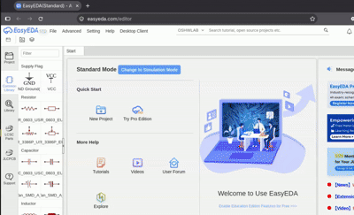

# **EasyEDA-Std.-2Kicad**

Paste a public **EasyEDA Standard** component link and get a KiCad 8/9/10 symbol and footprint on your computer. The app exports 2D libraries only. No account or search is needed. If you give it several links, it processes them one at a time.

<p align="center">
  
</p>

## Quick start 🚀

You need [Git](https://git-scm.com/downloads) and [Python 3.11 or newer](https://www.python.org/downloads/). On Windows, enable **Add Python to PATH** during installation.

Open a terminal and use the three commands for your system below.

**Windows CMD:**

```bat
git clone https://github.com/wysemon/EasyEDA-Std.-2Kicad.git
cd EasyEDA-Std.-2Kicad
run https://easyeda.com/component/7db93ef938c54a728e02f6579db05977
```

**Linux or macOS:**

```sh
git clone https://github.com/wysemon/EasyEDA-Std.-2Kicad.git
cd EasyEDA-Std.-2Kicad
./run.sh https://easyeda.com/component/7db93ef938c54a728e02f6579db05977
```

The first run creates a local `.venv` and installs the app. Later runs reuse it. Dependencies refresh automatically when `pyproject.toml` changes.

Your KiCad files appear in `output/`. The terminal prints their full paths and a short summary when it finishes.

### Paste links interactively

Run `run` on Windows or `./run.sh` on Linux/macOS without arguments. Paste one link at each prompt, then press Enter on an empty line to finish.

If you already have a `links.txt` file, the app asks whether to use it. Press Enter for yes. The file accepts one link or UUID per line, with blank lines and `#` comments allowed. Invalid entries are reported individually, with line numbers for files; valid entries still run in order, with duplicate UUIDs processed once. Any invalid entry makes the command exit with code 1.

## Import into KiCad 🔌

Use the **full paths printed at the end of the run**:

1. Open **Preferences > Manage Symbol Libraries** and add the `.kicad_sym` file.
2. Open **Preferences > Manage Footprint Libraries** and add the `.pretty` folder.
3. Give both libraries the generated name, such as `MAX98357A_NO_HOLES_7db93ef9`.
4. In the Schematic Editor, press **A**, find the symbol, and place it.

The symbol already points to the matching footprint. Library names include the first eight characters of the component UUID to distinguish matching titles. If two full UUIDs still produce the same output name, the app stops that item and keeps the existing folder. Choose a different `--output` folder for the other component.

Only Reference and Value are shown as properties. Source information, authors and other metadata remain stored but hidden. Symbol drawing text is capped at 75 mil (1.905 mm); smaller text stays smaller. Footprint drawing text keeps the source sizes. Pin labels and Reference/Value use 1.27 mm.

## What a run produces

For this link:

```text
https://easyeda.com/component/7db93ef938c54a728e02f6579db05977
```

The output folder looks like this:

```text
output/
├── fetch_log.tsv
└── MAX98357A_NO_HOLES_7db93ef9/
    ├── raw.json
    ├── CREDITS.txt
    ├── MAX98357A_NO_HOLES_7db93ef9.kicad_sym
    └── MAX98357A_NO_HOLES_7db93ef9.pretty/
        └── MAX98357A_NO_HOLES_7db93ef9.kicad_mod
```

The summary below uses an example Linux checkout location. Your printed paths will match your own folder.

```text
Summary: 1 succeeded, 0 failed, 0 skipped.
Output: /home/me/EasyEDA-Std.-2Kicad/output
add /home/me/EasyEDA-Std.-2Kicad/output/MAX98357A_NO_HOLES_7db93ef9/MAX98357A_NO_HOLES_7db93ef9.kicad_sym in Symbol Libraries
add /home/me/EasyEDA-Std.-2Kicad/output/MAX98357A_NO_HOLES_7db93ef9/MAX98357A_NO_HOLES_7db93ef9.pretty in Footprint Libraries
```

Components with no footprint geometry or footprint UUID export a symbol only. The app
prints a warning, leaves the Footprint field empty, and creates no `.pretty` folder.

`raw.json` preserves the original API response. `CREDITS.txt` keeps the authors, source link, full description and any source license. A separate footprint lookup adds `package_raw.json`. `fetch_log.tsv` records each item's time and status.

The MAX98357A example warns about duplicate pin numbers 1 and 2. These are in the source: speaker pins +/-- share numbers with header pins. All nine symbol pins and seven footprint pads are kept.

## Useful commands

The examples below use Windows CMD. On Linux/macOS, replace `run` with `./run.sh`.

| Task | Command |
| --- | --- |
| Read a list of links | `run --file links.txt` |
| Choose an output folder | `run <link> --output "my libraries"` |
| Rebuild a cached component offline | `run convert <uuid>` |
| Check a cached conversion with KiCad | `run convert <uuid> --validate` |
| Try a conversion without saving output | `run <link> --dry-run` |
| Show detailed errors | `run <link> --verbose` |
| Print the app version | `run --version` |

You can use bare 32-hex UUIDs or component URLs from `easyeda.com` and `www.easyeda.com`. Trailing slashes, query strings and fragments are accepted. Several links or UUIDs may be passed on the same command line.

**Quote links containing `&`, and quote paths containing spaces.** For example:

```bat
run "https://easyeda.com/component/7db93ef938c54a728e02f6579db05977?a=1&b=2"
```

### Caching and validation

Complete 2D libraries are skipped. New output has a hidden completion record; older output is checked against the cached pin and pad counts. Completion also requires matching full UUIDs in the cache, completion record and symbol, with matching symbol/footprint names. Identity conflicts fail without replacing existing files, even with `--force`. If only raw data is cached, or output is incomplete, the app reports `re-converting from cache` and rebuilds without downloading again. Missing cached footprint data produces an offline error; it never triggers a hidden download.

Use `convert` after updating the app to rebuild existing output offline. For older output, add the newly generated UUID-suffixed libraries in KiCad. `--force` downloads fresh component data and overwrites generated output.

`--validate` runs KiCad's upgrade commands on temporary copies and reports PASS/FAIL. It leaves your originals untouched. Explicit `--validate` fails if `kicad-cli` is missing from PATH. Install KiCad 8/9/10 and add its command-line tools to PATH, then try again. This checks that KiCad can read the libraries; it does not check the design's electrical or manufacturing rules.

`--dry-run` uses a temporary directory and does not save output or change the log. Cached dry runs make no requests, even with `--force`. An uncached dry run may fetch component data.

### Safe updates and older output

New libraries are built in a temporary folder and checked before they replace anything. With `--validate`, KiCad must accept them too. A hidden completion record tracks the generated files. If writing or validation fails, the previous libraries stay available. After an interrupted publish, the next normal run restores the previous files. Use `convert` to rebuild again if those previous files are already complete. Dry runs leave your output untouched. Run only one converter process per output folder.

Old converter-generated footprints with model references are rebuilt from their cache automatically, including older library names. Unassociated libraries are left alone with a manual-cleanup warning. No model files are deleted. You can remove unused STEP/WRL files yourself after checking that other projects do not use them. Raw JSON containing `SVGNODE` metadata is harmless and stays unchanged.

Rebuild explicitly with `run convert <uuid>` (Linux/macOS: `./run.sh convert <uuid>`). Keep a copy of any hand-edited libraries. Changed older libraries and detected hand edits are also saved in a `.previous-<hash>` file before rebuilding. Changed attribution is kept in `CREDITS.previous-<hash>.txt`. Libraries created by other tools are never overwritten.

### Files are relative to where you run the command

The launchers install from the checkout, but `--file`, `--output`, default `output/`, and interactive `links.txt` use the directory you started in. Calling the launcher by its full path from another folder works too.

The launchers pass this location through `EE2KICAD_CWD`. Installed console commands use the current directory unless that variable is set. Windows CMD restores its original console code page on exit.

## Troubleshooting

| Problem | What to try |
| --- | --- |
| Python is missing | Install Python 3.11+ and enable PATH on Windows. On Debian/Ubuntu, you may also need `python3-venv`. |
| HTTP 403 or 429 | Stop and wait. Check that the component is public. Do not retry rapidly or bypass access restrictions. |
| No internet | Check the connection and proxy settings. Cached `convert` still works offline. |
| Private component or `success:false` | Use a public EasyEDA Standard component link. The app does not log in or bypass permissions. |
| Symbol looks tiny or far from the origin | Update the app, run `run convert <uuid>` (or `./run.sh convert <uuid>`), then reload the library in KiCad. Older output may have used zero for a missing EasyEDA origin. |
| Text or pins look wrong | Update the app and re-convert the cache. Check the source and warnings before using the result. Include the raw record when reporting a bug. |
| Duplicate pin warning | All pins are kept. Check the source and connectivity in KiCad; the duplicate may be intentional. |
| Dependencies need refreshing | Changes to `pyproject.toml` trigger this automatically. Delete `.venv/.ee2kicad-ready` to force a refresh. |
| Windows path is too long | Keep the checkout and output paths short. Sanitized titles use at most 60 ASCII characters, followed by `_uuid8`. |

## Be a polite client 🤝

The app deliberately pauses between requests. The default is **4 seconds plus 0–2 seconds of random jitter**, including retries and footprint lookups. Requests use one client and run sequentially. Caching avoids repeat downloads.

`--delay` changes the base cooldown, with a minimum of 1 second. Keep the default unless you have a reason to change it.

403/429/5xx responses honor `Retry-After`, capped at 300 seconds with a warning. Otherwise, retries wait 30 then 60 seconds, with at most three attempts. **Two consecutive 403/429 responses stop the whole run**, including during retries. Other item failures are logged and processing continues; any failure gives a nonzero exit status.

TLS verification stays enabled. Redirects, logins, captchas and paywalls are not bypassed. The app contacts only easyeda.com.

## Limits and source rights

- Some record types and rotation conventions remain unverified. See [API notes](docs/API_NOTES.md). Unsupported decorative records warn and are skipped. Malformed pins, pads, holes, vias or supported copper records fail the component so electrical geometry cannot silently disappear. Unknown electrical types warn and become unspecified. Multi-unit symbols use the verified `result.subparts` layout. Incomplete or unsupported unit layouts fail instead of exporting only part of a component.
- Circular SVG arcs become KiCad arcs. Elliptical arcs use sampled polylines. Pads support round, rectangular, oval and custom polygons, with through-hole or SMD layers.
- Filled SVG regions support one straight-edged contour. Compound fills, self-intersecting or touching copper contours, and custom pads whose anchor would add copper are rejected. Copper polygons are limited to 1,000 vertices to bound intersection checks. Separate stroked contours remain supported. Invalid copper widths, empty copper geometry and malformed or unsupported copper text fail the component before publication. Unknown through-hole plating flags warn and default to plated.
- Real asymmetric pads and an oval USB-C slot now have source-to-native-KiCad checks. Some custom shapes, rear-side conventions and text placement still need real component comparisons.
- Courtyards cover pads, holes and non-text body outlines, with 0.25 mm clearance. They are a starting point, not a clearance certification.
- Review geometry, drills, pin mapping and clearances before fabrication. There is no manufacturability guarantee.
- Public component data may have third-party restrictions. Attribution does not grant redistribution rights. Review the source and each generated `CREDITS.txt`.

## Other installation options

After `pip install -e .`, use `euc2k <link>` without a subcommand. `euc2k` stands for EasyEDA User Contributed. The command also accepts `fetch ...`, `convert ...`, or no arguments for prompts.

For a global command isolated from other projects, use `pipx install .` or `uv tool install .` from this checkout. These require pipx or uv and their tool directory on PATH.

## Development checks

On Linux/macOS, after setup:

```sh
.venv/bin/python -m pip install -e '.[test]'
.venv/bin/python -m pytest
.venv/bin/python -m ruff check .
.venv/bin/python -m ruff format --check .
```

On Windows, use `.venv\Scripts\python` instead of `.venv/bin/python`, and use double quotes around `".[test]"`.

The normal suite is offline. KiCad integration checks skip when its CLI is unavailable. `euc2k --version` prints the installed version.

Files use one shared KiCad 8 format, verified with **KiCad 8.0.9, 9.0.9 and 10.0.7** in isolated Ubuntu 24.04 environments. Each passes 37 native checks covering imports, upgrades, rendering, essential properties, pad placement, drills and layers. CI keeps the Python 3.11/3.12 Windows/Linux matrix and tests all three KiCad majors from the KiCad team’s maintained stable PPAs. Each job verifies both CLI and Python binding versions before testing. Native KiCad on Windows/macOS and manual GUI inspection are not covered; see [API notes](docs/API_NOTES.md) for remaining geometry limits.

To run just the native checks after installing KiCad:

```sh
.venv/bin/python -m pytest -m "kicad and not live"
```

Strict `--validate` checks file import, not ERC, DRC or fabrication suitability.

### Optional live smoke test

`pytest -m live` opts into fetching exactly one public component through the normal paced client, including its retry/stop rules. It makes no search or footprint fallback requests and writes no output files.

The normal suite deselects it. CI never runs it; `CI` or `EE2KICAD_DISABLE_LIVE` also forces a skip even with `-m live`. Other tests continue to block HTTP requests.

## Project documentation

- [Contributing](CONTRIBUTING.md): setup, code map, formatting and test commands.
- [API and format notes](docs/API_NOTES.md): verified conventions and remaining limits.
- [Report a problem](https://github.com/wysemon/EasyEDA-Std.-2Kicad/issues): include the component link, command and relevant warning.

## Credits and license

Independent implementation from the supplied API/format description and real
fixtures, released under the repository's MIT license. No upstream code copied.
Related tools and format research:
[easyeda2kicad.py](https://github.com/uPesy/easyeda2kicad.py) (AGPL-3.0) and
[JLC2KiCadLib](https://github.com/TousstNicolas/JLC2KiCadLib).
Their source code was not incorporated. Component authors retain their rights;
see each generated CREDITS.txt.

The [geometry test data](tests/fixtures/geometry/README.md) has a separate
CC-BY-NC-SA 3.0 license and source attribution. The converter code stays MIT.
